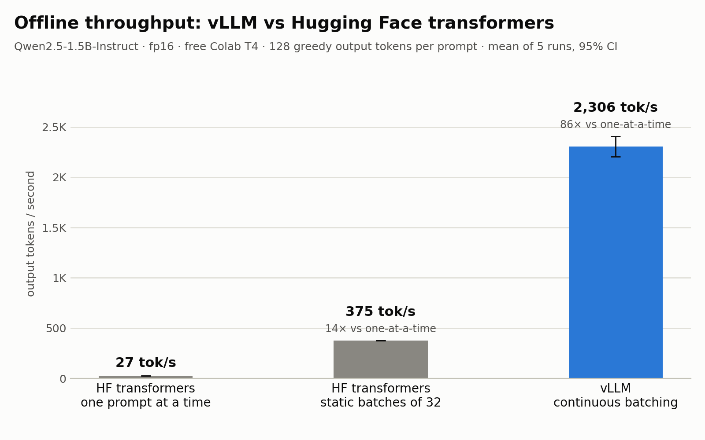

# vLLM vs Hugging Face transformers on a free Colab T4

How much faster is [vLLM](https://github.com/vllm-project/vllm) than plain Hugging Face `transformers` on the free GPU everyone has access to? This repo measures it with one small model, on one free Google Colab T4, using a setup that is the same for every method.



> _Results pending: the chart and numbers below are placeholders until the first full run._

- **TBD× the throughput of HF batched generation**: vLLM TBD tokens/s vs TBD tokens/s for HF with static batches of 32 (TBD× vs one prompt at a time).
- **TBD tokens/s at 64 concurrent streaming requests** from `vllm serve`, with p95 latency of TBD s per 128-token response.
- **TBD tokens of KV cache (TBD GiB)**: what vLLM fit on the T4 next to the model.

## Why vLLM is faster

Generating text one token at a time has two costs:
- **Reading the weights.** Every decoding step reads all of the model's weights from GPU memory (about 3 GB here), whether the step produces 1 token or 200. So the more sequences you decode together, the cheaper each token gets.
- **Storing the KV cache.** Each sequence in flight keeps the attention keys and values of every token it has seen (the "KV cache"). On a 16 GB GPU, KV cache memory decides how many sequences fit at once.

vLLM is built around making that batch as large as possible and keeping it full.

**1. Paged memory for the KV cache (PagedAttention).** HF `transformers` stores each sequence's KV cache as one contiguous tensor, and in a batch every sequence is padded to the longest one. vLLM cuts the KV cache into small fixed-size blocks of 16 tokens and hands them out as a sequence grows, like an operating system handing out memory pages. Almost nothing is wasted on padding or on space reserved "just in case", so many more sequences fit on the same GPU.

**2. Continuous batching.** With static batching (HF `generate()` on a batch), the whole batch starts together and finishes together. Short sequences wait for the longest one, and new requests wait for the whole batch. vLLM's scheduler works one decoding step at a time instead. As soon as a sequence finishes, its blocks are freed and a waiting request takes its place on the very next step, so the GPU never idles with half-empty batches.

On top of that, vLLM captures CUDA graphs and uses fused attention kernels, which cut the per-step Python and kernel-launch overhead that dominates small-model decoding in HF.

## Reproduce on free Colab

You need no local GPU. You edit locally in VS Code, and the notebook runs on a free Colab T4.

1. Install [VS Code](https://code.visualstudio.com/) with the **Jupyter** and **Google Colab** extensions from the Extensions view.
2. Clone this repo (or download just `benchmark.ipynb`) and open `benchmark.ipynb` in VS Code.
3. Click **Select Kernel** (top right), then **Colab** → **New Colab Server**, sign in with your Google account and choose **GPU → T4**. When it's connected, the kernel picker shows the Colab runtime.
   _No VS Code? Open the notebook in [Colab](https://colab.research.google.com/) in the browser and choose Runtime → Change runtime type → T4 GPU._
4. **Run All** (about 30–40 minutes). The notebook clones this repo onto the runtime, installs the pinned `requirements.txt`, builds the prompt set and runs each benchmark as its own `!python` process. The last cell shows the charts and prints the CSVs.
5. The Colab runtime is a remote machine, so copy the two printed CSVs into your local `results/` folder, then redraw the charts locally:

   ```bash
   pip install -r requirements-plot.txt
   python src/plot.py
   ```

To run the steps one by one (on the GPU machine):

```bash
pip install -r requirements.txt
python src/prompts.py                          # 200 fixed prompts -> data/prompts.json
python src/offline_bench.py --method hf_naive
python src/offline_bench.py --method hf_batched
python src/offline_bench.py --method vllm
python src/load_test.py                        # vllm serve + concurrency 1, 4, 16, 64
python src/summarize.py                        # results/raw/*.json -> results/*.csv
python src/plot.py                             # results/*.csv -> results/*.png
```

**Troubleshooting**
- **vLLM fails with an attention-kernel error.** On the T4, vLLM picks the FlashInfer attention backend (FlashAttention needs a newer GPU). If FlashInfer fails, add `--attention-backend TRITON_ATTN` to the `offline_bench.py --method vllm` and `load_test.py` commands.
- **Out of GPU memory.** Each benchmark frees the GPU when its process exits. Check `!nvidia-smi` for a leftover process from an interrupted cell, and restart the runtime if needed. If vLLM itself runs out of memory, lower `GPU_MEMORY_UTILIZATION` in `src/common.py` (see Methodology).
- **The session disconnects.** Free Colab sessions disconnect when idle; keep the notebook open while it runs.

## Methodology

**Shared setup (identical for every method)**
- **Model:** [`Qwen/Qwen2.5-1.5B-Instruct`](https://huggingface.co/Qwen/Qwen2.5-1.5B-Instruct) in float16 (the T4 has no bf16 support).
- **Prompts:** 200 prompts from [`databricks/databricks-dolly-15k`](https://huggingface.co/datasets/databricks/databricks-dolly-15k), shuffled with seed 42. Each prompt is the instruction plus its context paragraph, formatted with the model's chat template. Prompts longer than 512 tokens are skipped, which keeps HF's padding waste bounded. `src/prompts.py` writes them once to `data/prompts.json`, and every method reads the same strings.
- **Decoding:** greedy, exactly 128 output tokens per prompt. vLLM uses `ignore_eos=True`; HF uses `min_new_tokens = max_new_tokens`.
- **No hidden sampling settings.** Qwen's `generation_config.json` turns on sampling and `repetition_penalty=1.1`. Both are switched off everywhere: vLLM gets `generation_config="vllm"`, and HF gets an explicit `GenerationConfig`. So all methods do the same work.
- **Token counting:** output tokens are counted from the generated token ids, never assumed. HF counts the non-padding ids after the prompt, vLLM uses `len(output.token_ids)`, and the server streams `token_ids` in each chunk via `return_token_ids`. Each result file records how many outputs were not exactly 128 tokens (expected: 0).
- **Isolation:** every method runs in its own Python process and writes its own JSON file. vLLM reserves most of the GPU memory at start-up, so it never shares a process with HF.
- **Prefix caching is off.** By default vLLM reuses the KV cache of prompt prefixes it has already seen. The timed runs repeat the same prompts, so later runs would skip most of the prompt processing. It is turned off (`enable_prefix_caching=False` / `--no-enable-prefix-caching`) so vLLM does the same work as HF on every run.

**Experiment 1: offline throughput** (`src/offline_bench.py`)

| Method | What it does | Prompts |
|---|---|---|
| `hf_naive` | `model.generate()` on one prompt at a time | first 32 (it is slow) |
| `hf_batched` | `model.generate()` on left-padded batches of 32, in fixed prompt order | 200 |
| `vllm` | a single `LLM.generate()` call on all prompts; vLLM schedules the batches | 200 |

- Each method does 1 discarded warm-up run, then 5 timed runs. Each timed run is wrapped in `torch.cuda.synchronize()`. vLLM runs the model in a separate engine process and `LLM.generate()` only returns when every request is done, so the wall clock is correct there too.
- The metric is output tokens per second, so `hf_naive` stays comparable despite using fewer prompts. It is reported as the mean with a t-based 95% confidence interval (mean ± t<sub>0.975, 4</sub> · s / √5; with only 5 runs a bootstrap interval is unreliable), plus the median.

**Experiment 2: online serving** (`src/load_test.py`)
- **Server:** `vllm serve Qwen/Qwen2.5-1.5B-Instruct --dtype half --max-model-len 4096 --gpu-memory-utilization 0.85 --no-enable-prefix-caching --generation-config vllm` runs as a background process. The script polls `/health` until the server is ready and shuts it down at the end.
- **Client:** an async `httpx` client sends streaming `/v1/completions` requests at concurrency 1, 4, 16 and 64. Each level sends max(64, 4 × concurrency) requests, cycling through the prompts. 8 warm-up requests are discarded first.
- **Per request:** time to first token (from sending the request to the first chunk containing a token) and total latency (to the last token).
- **Per level:** output tokens/s (all output tokens divided by the level's wall time), p50 and p95 latency, and p50 time to first token.

**Memory: why there is no "peak memory" number for vLLM**
- **HF:** we report `torch.cuda.max_memory_allocated()`, which covers the weights, KV cache and activations at their peak.
- **vLLM preallocates by design.** At start-up it claims `gpu_memory_utilization` of the GPU's memory, loads the weights, measures how much activation memory a forward pass needs, and turns everything left over into a pool of KV-cache blocks. Its memory footprint is therefore fixed by that setting whatever the workload, and a "peak" number would only measure the setting.
- **We use 0.85, not vLLM's default 0.9.** In vLLM 0.19.0, CUDA graphs (about 0.75 GiB here) and the CUDA runtime's own memory sit outside the reservation. On the T4's 14.56 GiB, the last 10% wasn't enough for them, and the first full batch ran out of memory. 0.85 still leaves room for roughly 320k tokens of KV cache, far more than this benchmark uses.
- **What we report for vLLM is the KV cache pool.** `kv_cache_tokens` matches the `GPU KV cache size: N tokens` line in vLLM's log. `kv_cache_gib` is its size: 28 KiB per token for this model (K and V × 28 layers × 2 KV heads × 128 dims × 2 bytes). Divided by 4096 (the max context), it tells you how many full-length requests fit at once.

## Limitations

- **One GPU, one Colab VM.** A T4 (Turing, 2019) with 16 GB. Numbers will differ on other GPUs and even between Colab sessions.
- **One small model.** 1.5B parameters. Larger models leave less room for the KV cache and shift the balance between compute and memory.
- **Greedy decoding only, with a fixed 128 output tokens and EOS ignored.** Real traffic has outputs of varying length, which tends to favour continuous batching even more.
- **fp16 on a model trained in bf16**, because the T4 has no bf16 support.
- **Plain HF baselines.** They use plain `generate()` with the default dynamic KV cache: no static cache, no `torch.compile` and no length-sorted batches. Those would narrow the gap.
- **The load-test client shares the server's machine.** Both run on Colab's 2 vCPUs, so at high concurrency some client CPU time ends up in the measured latency.
- **Short prompts only.** Prompts are capped at 512 tokens, so long-context workloads aren't covered.

## Repo layout

```
benchmark.ipynb          # runs everything on Colab
src/prompts.py           # builds the 200 fixed prompts
src/offline_bench.py     # Experiment 1: hf_naive / hf_batched / vllm
src/load_test.py         # Experiment 2: vllm serve + async streaming client
src/summarize.py         # raw JSON -> results/*.csv
src/plot.py              # results/*.csv -> results/*.png
src/common.py            # shared settings and helpers
requirements.txt         # pinned versions for the Colab GPU runtime (vllm 0.19.0, torch 2.10.0, CUDA 12.8)
requirements-plot.txt    # pandas + matplotlib, for plotting locally
```

## License

MIT
